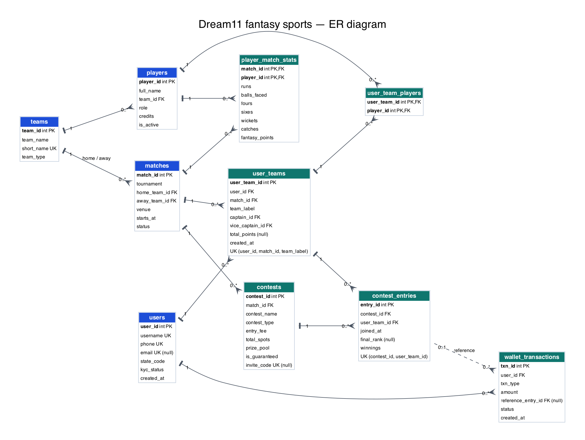
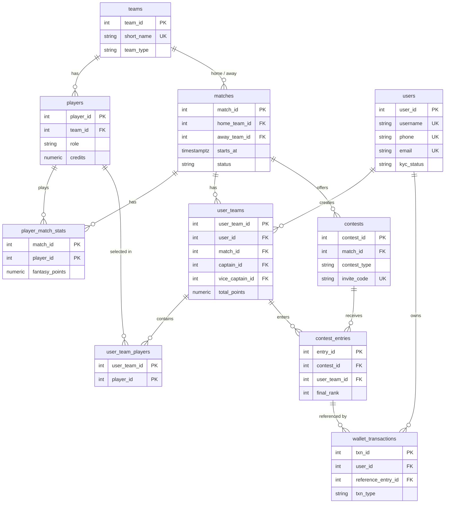

# Phase 2 — Schema design

The database is built from the ten CSV exports, not from a supplied schema. Every column name comes from the CSV header, every table name from the file name, and every constraint was tested by loading all 698,657 rows. The schema lives in PostgreSQL's `dream11` schema; the workload in `queries/workload_30.sql` runs unqualified names after `SET search_path TO dream11`.

## 1. Design goals

- Accept every row in the ten seed files. A constraint that rejects a real export row is either wrong or has found a data problem; this document records which.
- Use the right type, not `TEXT` everywhere: integers for ids, `NUMERIC` for money and points, `TIMESTAMPTZ` for timestamps, `BOOLEAN` for flags.
- Create only primary keys, unique constraints, foreign keys, `NOT NULL` and `CHECK` constraints in this phase. No extra indexes: the Phase 3 baseline must measure an un-tuned database.
- Keep the fixed workload runnable without editing a query. Three details drive the design: W01–W03 insert explicit ids, W01 omits `total_points`, and W02 uses `ON CONFLICT (contest_id, user_team_id)`.

## 2. Tables at a glance

| Table | Rows | What it stores |
| --- | ---: | --- |
| `teams` | 18 | IPL franchises and international teams |
| `players` | 450 | Player squads, role, credits and active flag |
| `matches` | 212 | Fixtures, venue, start time and status |
| `player_match_stats` | 4,444 | One performance line per player per match |
| `users` | 50,000 | Dream11 users, contact, state and KYC status |
| `user_teams` | 39,975 | A user's fantasy XI for one match, plus captain and vice-captain |
| `user_team_players` | 439,925 | The 11 players in each fantasy team |
| `contests` | 2,544 | Contest definition, fee, spots and prize pool |
| `contest_entries` | 42,746 | A fantasy team's entry into a contest, rank and winnings |
| `wallet_transactions` | 118,343 | Deposits, fees, winnings, refunds, bonuses and withdrawals |

## 3. Data dictionary

Each row gives the column, its PostgreSQL type, its constraints, and why it exists.

### `teams` (18 rows)

| Column | Type | Constraints | Why |
| --- | --- | --- | --- |
| `team_id` | `INTEGER` | PK | Stable id from the export; referenced by players and matches. |
| `team_name` | `VARCHAR(60)` | NOT NULL | Display name; not unique because two teams could share a name. |
| `short_name` | `VARCHAR(4)` | NOT NULL, UNIQUE, CHECK `^[A-Z]{2,4}$` | Scoreboard code (CSK, MI, IND); unique natural key. |
| `team_type` | `VARCHAR(20)` | NOT NULL, CHECK in FRANCHISE / INTERNATIONAL | Distinguishes IPL sides from national teams. |

### `players` (450 rows)

| Column | Type | Constraints | Why |
| --- | --- | --- | --- |
| `player_id` | `INTEGER` | PK | Stable id from the export. |
| `full_name` | `VARCHAR(60)` | NOT NULL | Display name; **not** unique — 330 distinct names for 450 players. |
| `team_id` | `INTEGER` | NOT NULL, FK → `teams` ON DELETE RESTRICT | The player's real team. |
| `role` | `VARCHAR(4)` | NOT NULL, CHECK in WK / BAT / AR / BOWL | Fantasy role. |
| `credits` | `NUMERIC(4,1)` | NOT NULL, CHECK > 0 and <= 100 | Selection cost; one decimal place. |
| `is_active` | `BOOLEAN` | NOT NULL | Whether the player is selectable. |

### `matches` (212 rows)

| Column | Type | Constraints | Why |
| --- | --- | --- | --- |
| `match_id` | `INTEGER` | PK | Stable id from the export. |
| `tournament` | `VARCHAR(40)` | NOT NULL | IPL 2025, IPL 2026, World T20 Series 2025, etc. |
| `home_team_id` | `INTEGER` | NOT NULL, FK → `teams` ON DELETE RESTRICT | Home side. |
| `away_team_id` | `INTEGER` | NOT NULL, FK → `teams` ON DELETE RESTRICT | Away side. |
| `venue` | `VARCHAR(80)` | NOT NULL | Venue text from the export. |
| `starts_at` | `TIMESTAMPTZ` | NOT NULL | Start time with the `+05:30` offset. |
| `status` | `VARCHAR(10)` | NOT NULL, CHECK in UPCOMING / LIVE / COMPLETED / ABANDONED | Drives lobby, points and refund queries. |

Table-level CHECK: `home_team_id <> away_team_id`.

### `player_match_stats` (4,444 rows)

| Column | Type | Constraints | Why |
| --- | --- | --- | --- |
| `match_id` | `INTEGER` | PK, FK → `matches` ON DELETE CASCADE | Part of the natural key. |
| `player_id` | `INTEGER` | PK, FK → `players` ON DELETE RESTRICT | Part of the natural key. |
| `runs` | `SMALLINT` | NOT NULL, CHECK >= 0 | Batting runs. |
| `balls_faced` | `SMALLINT` | NOT NULL, CHECK >= 0 | Balls faced. |
| `fours` | `SMALLINT` | NOT NULL, CHECK >= 0 and <= `balls_faced` | Boundaries. |
| `sixes` | `SMALLINT` | NOT NULL, CHECK >= 0 | Sixes. |
| `wickets` | `SMALLINT` | NOT NULL, CHECK 0–10 | Bowling wickets. |
| `catches` | `SMALLINT` | NOT NULL, CHECK >= 0 | Catches. |
| `fantasy_points` | `NUMERIC(6,1)` | NOT NULL, CHECK >= 0 | Scoring output for the match. |

Table-level CHECK: `fours * 4 + sixes * 6 <= runs` (boundary runs cannot exceed total runs).

### `users` (50,000 rows)

| Column | Type | Constraints | Why |
| --- | --- | --- | --- |
| `user_id` | `INTEGER` | PK | Stable id from the export. |
| `username` | `VARCHAR(25)` | NOT NULL, UNIQUE, CHECK `^[A-Za-z][A-Za-z0-9_]{2,24}$` | Login handle; 3–25 characters. |
| `phone` | `VARCHAR(10)` | NOT NULL, UNIQUE, CHECK `^[6-9][0-9]{9}$` | Indian mobile number; R23 logs in with it. |
| `email` | `VARCHAR(80)` | UNIQUE, nullable, CHECK contains `@` and a dot | Optional contact; 19,935 users have none. |
| `state_code` | `CHAR(2)` | NOT NULL, CHECK `^[A-Z]{2}$` | Compliance state; R11 filters four states. |
| `kyc_status` | `VARCHAR(10)` | NOT NULL, CHECK in PENDING / VERIFIED / REJECTED | Tax and payout checks. |
| `created_at` | `TIMESTAMPTZ` | NOT NULL | Signup time. |

### `user_teams` (39,975 rows)

| Column | Type | Constraints | Why |
| --- | --- | --- | --- |
| `user_team_id` | `INTEGER` | PK | Stable id; W01 inserts `90000001` explicitly. |
| `user_id` | `INTEGER` | NOT NULL, FK → `users` ON DELETE RESTRICT | Owner. |
| `match_id` | `INTEGER` | NOT NULL, FK → `matches` ON DELETE RESTRICT | Match the team was built for. |
| `team_label` | `VARCHAR(3)` | NOT NULL, CHECK T1–T11 | T1, T2, … shown in "My teams". |
| `captain_id` | `INTEGER` | NOT NULL, FK → `players` ON DELETE RESTRICT | 2× points. |
| `vice_captain_id` | `INTEGER` | NOT NULL, FK → `players` ON DELETE RESTRICT | 1.5× points. |
| `total_points` | `NUMERIC(6,1)` | nullable, CHECK >= 0 | Settled team score; W01 omits it, and it is null until the match completes. |
| `created_at` | `TIMESTAMPTZ` | NOT NULL | When the team was saved. |

Table-level constraints: `UNIQUE (user_id, match_id, team_label)` and `captain_id <> vice_captain_id`.

### `user_team_players` (439,925 rows)

| Column | Type | Constraints | Why |
| --- | --- | --- | --- |
| `user_team_id` | `INTEGER` | PK, FK → `user_teams` ON DELETE CASCADE | The fantasy team. |
| `player_id` | `INTEGER` | PK, FK → `players` ON DELETE RESTRICT | One of its players. |

This is an all-key relation: its only attributes are the two foreign keys. The 11-player rule is cross-row and is not a `CHECK`.

### `contests` (2,544 rows)

| Column | Type | Constraints | Why |
| --- | --- | --- | --- |
| `contest_id` | `INTEGER` | PK | Stable id from the export. |
| `match_id` | `INTEGER` | NOT NULL, FK → `matches` ON DELETE RESTRICT | The match the contest belongs to. |
| `contest_name` | `VARCHAR(40)` | NOT NULL | Display name. |
| `contest_type` | `VARCHAR(15)` | NOT NULL, CHECK in MEGA / SMALL / HEAD_TO_HEAD / PRIVATE | Drives the contest list and fill-rate report. |
| `entry_fee` | `NUMERIC(10,2)` | NOT NULL, CHECK >= 0 | Entry price; 0 would be a free contest. |
| `total_spots` | `INTEGER` | NOT NULL, CHECK > 0 | Capacity. |
| `prize_pool` | `NUMERIC(12,2)` | NOT NULL, CHECK >= 0 | Advertised payout; a business value, not `fee × spots`. |
| `is_guaranteed` | `BOOLEAN` | NOT NULL | Guaranteed-prize flag. |
| `invite_code` | `VARCHAR(8)` | UNIQUE, nullable, CHECK `^[A-Z0-9]{8}$` | Only private contests have one; 2,120 rows are null. |

Table-level CHECK: `(contest_type = 'PRIVATE') = (invite_code IS NOT NULL)` and `contest_type <> 'HEAD_TO_HEAD' OR total_spots = 2`.

### `contest_entries` (42,746 rows)

| Column | Type | Constraints | Why |
| --- | --- | --- | --- |
| `entry_id` | `INTEGER` | PK | Stable id; W02 inserts `90000001` explicitly. |
| `contest_id` | `INTEGER` | NOT NULL, FK → `contests` ON DELETE RESTRICT | Contest joined. |
| `user_team_id` | `INTEGER` | NOT NULL, FK → `user_teams` ON DELETE RESTRICT | Team entered. |
| `joined_at` | `TIMESTAMPTZ` | NOT NULL | When the entry was created. |
| `final_rank` | `INTEGER` | nullable, CHECK > 0 | Null until the contest is settled; 2,125 rows are null. |
| `winnings` | `NUMERIC(10,2)` | NOT NULL, DEFAULT 0, CHECK >= 0 | Payout; 0 when unranked. |

Table-level constraints: `UNIQUE (contest_id, user_team_id)` — required by W02's `ON CONFLICT` — and `final_rank IS NOT NULL OR winnings = 0`.

### `wallet_transactions` (118,343 rows)

| Column | Type | Constraints | Why |
| --- | --- | --- | --- |
| `txn_id` | `INTEGER` | PK | Stable id; W03 inserts `90000001` explicitly. |
| `user_id` | `INTEGER` | NOT NULL, FK → `users` ON DELETE RESTRICT | Account owner. |
| `txn_type` | `VARCHAR(12)` | NOT NULL, CHECK in DEPOSIT / WITHDRAWAL / ENTRY_FEE / WINNINGS / REFUND / BONUS | Ledger type. |
| `amount` | `NUMERIC(10,2)` | NOT NULL, CHECK > 0 | Positive amount; direction comes from `txn_type`. |
| `reference_entry_id` | `INTEGER` | nullable, FK → `contest_entries` ON DELETE RESTRICT | Set only for ENTRY_FEE, WINNINGS and REFUND; 63,000 rows are null. |
| `status` | `VARCHAR(10)` | NOT NULL, CHECK in SUCCESS / PENDING / FAILED | Payout and refund state. |
| `created_at` | `TIMESTAMPTZ` | NOT NULL | Ledger time; R09 orders by it. |

Table-level CHECK: `(txn_type IN ('ENTRY_FEE','WINNINGS','REFUND')) = (reference_entry_id IS NOT NULL)`.

## 4. Keys, foreign keys and delete rules

| Child column | Parent | On delete | Why |
| --- | --- | --- | --- |
| `players.team_id` | `teams` | RESTRICT | A team with players is historical data. |
| `matches.home_team_id`, `away_team_id` | `teams` | RESTRICT | Deleting a team would orphan fixtures. |
| `player_match_stats.match_id` | `matches` | CASCADE | A stat line belongs to its match. |
| `player_match_stats.player_id` | `players` | RESTRICT | A player with score history cannot be removed. |
| `user_teams.user_id` | `users` | RESTRICT | A user's teams are history. |
| `user_teams.match_id` | `matches` | RESTRICT | A match with fantasy teams cannot be removed. |
| `user_teams.captain_id`, `vice_captain_id` | `players` | RESTRICT | Captaincy is player history. |
| `user_team_players.user_team_id` | `user_teams` | CASCADE | The XI is a composition of the team. |
| `user_team_players.player_id` | `players` | RESTRICT | Selection history matters. |
| `contests.match_id` | `matches` | RESTRICT | A contest is part of a match's history. |
| `contest_entries.contest_id` | `contests` | RESTRICT | An entry is a financial record. |
| `contest_entries.user_team_id` | `user_teams` | RESTRICT | An entry references a real team. |
| `wallet_transactions.user_id` | `users` | RESTRICT | The ledger must never lose rows. |
| `wallet_transactions.reference_entry_id` | `contest_entries` | RESTRICT | A ledger row points at a real entry. |

The rule is deliberate: composition tables (`player_match_stats`, `user_team_players`) may cascade with their parent; anything financial or historical uses `RESTRICT`.

## 5. CHECK constraints

There are more than the required 12. Each one was tested against every seed row.

| # | Table | Constraint |
| ---: | --- | --- |
| 1 | `teams` | `short_name ~ '^[A-Z]{2,4}$'` |
| 2 | `teams` | `team_type IN ('FRANCHISE','INTERNATIONAL')` |
| 3 | `players` | `role IN ('WK','BAT','AR','BOWL')` |
| 4 | `players` | `credits > 0 AND credits <= 100` |
| 5 | `matches` | `home_team_id <> away_team_id` |
| 6 | `matches` | `status IN ('UPCOMING','LIVE','COMPLETED','ABANDONED')` |
| 7 | `player_match_stats` | `runs, balls_faced, fours, sixes, catches, fantasy_points >= 0` |
| 8 | `player_match_stats` | `wickets BETWEEN 0 AND 10` |
| 9 | `player_match_stats` | `fours * 4 + sixes * 6 <= runs` |
| 10 | `player_match_stats` | `fours <= balls_faced` |
| 11 | `users` | `username ~ '^[A-Za-z][A-Za-z0-9_]{2,24}$'` |
| 12 | `users` | `phone ~ '^[6-9][0-9]{9}$'` |
| 13 | `users` | email is null or matches `local@domain.tld` |
| 14 | `users` | `state_code ~ '^[A-Z]{2}$'` |
| 15 | `users` | `kyc_status IN ('PENDING','VERIFIED','REJECTED')` |
| 16 | `user_teams` | `captain_id <> vice_captain_id` |
| 17 | `user_teams` | `team_label` is T1–T11 |
| 18 | `user_teams` | `total_points IS NULL OR total_points >= 0` |
| 19 | `contests` | `contest_type IN ('MEGA','SMALL','HEAD_TO_HEAD','PRIVATE')` |
| 20 | `contests` | `entry_fee >= 0` |
| 21 | `contests` | `total_spots > 0` |
| 22 | `contests` | `prize_pool >= 0` |
| 23 | `contests` | `(contest_type = 'PRIVATE') = (invite_code IS NOT NULL)` |
| 24 | `contests` | `invite_code IS NULL OR invite_code ~ '^[A-Z0-9]{8}$'` |
| 25 | `contests` | `contest_type <> 'HEAD_TO_HEAD' OR total_spots = 2` |
| 26 | `contest_entries` | `final_rank IS NULL OR final_rank > 0` |
| 27 | `contest_entries` | `winnings >= 0` |
| 28 | `contest_entries` | `final_rank IS NOT NULL OR winnings = 0` |
| 29 | `wallet_transactions` | `txn_type IN ('DEPOSIT','WITHDRAWAL','ENTRY_FEE','WINNINGS','REFUND','BONUS')` |
| 30 | `wallet_transactions` | `amount > 0` |
| 31 | `wallet_transactions` | `status IN ('SUCCESS','PENDING','FAILED')` |
| 32 | `wallet_transactions` | reference is required exactly for ENTRY_FEE / WINNINGS / REFUND |

## 6. Nullable columns and why

| Column | Nulls | Why it is nullable |
| --- | ---: | --- |
| `users.email` | 19,935 | Email is optional; 40% of users signed up with a phone only. Unique when present. |
| `user_teams.total_points` | 2,098 | Exactly the teams in UPCOMING (1,409), LIVE (226) and ABANDONED (463) matches. Points exist only after a completed match. W01 also omits the column. |
| `contest_entries.final_rank` | 2,125 | The contest has not been settled. Every null rank has `winnings = 0`. |
| `contests.invite_code` | 2,120 | Exactly the non-PRIVATE contests (2,544 − 424). A public contest has no code. |
| `wallet_transactions.reference_entry_id` | 63,000 | Exactly DEPOSIT, WITHDRAWAL and BONUS rows. Only entry-related transaction types reference an entry. |

Every other column is `NOT NULL`. The null patterns are not accidents; they match the business state and are enforced by the CHECK constraints above.

## 7. Functional dependencies and normal form

| Relation | Functional dependencies | Candidate keys | Normal form |
| --- | --- | --- | --- |
| `teams` | `team_id → all`; `short_name → all` | `team_id`, `short_name` | BCNF |
| `players` | `player_id → all` | `player_id` | BCNF |
| `matches` | `match_id → all` | `match_id` | BCNF |
| `player_match_stats` | `(match_id, player_id) → all` | `(match_id, player_id)` | BCNF |
| `users` | `user_id → all`; `username → all`; `phone → all`; `email → all` when present | `user_id`, `username`, `phone`, `email` | BCNF |
| `user_teams` | `user_team_id → all`; `(user_id, match_id, team_label) → all` | both | BCNF |
| `user_team_players` | `(user_team_id, player_id) → nothing else` | the pair | BCNF (all-key) |
| `contests` | `contest_id → all`; `invite_code → all` when present | `contest_id`, `invite_code` | BCNF |
| `contest_entries` | `entry_id → all`; `(contest_id, user_team_id) → all` | both | BCNF |
| `wallet_transactions` | `txn_id → all` | `txn_id` | BCNF |

`players.full_name` is not a determinant: 330 names are shared by 450 players. `teams.team_name` is not unique either. The nullable unique columns (`email`, `invite_code`) are candidate keys only for rows where they are present; PostgreSQL's unique indexes allow multiple nulls, which is the right behaviour.

Every relation is in 3NF and BCNF: no non-prime attribute depends on part of a key, no non-prime attribute depends on another non-prime attribute, and every determinant is a candidate key.

## 8. Derived or redundant columns

| Column | Derived from | Why it is kept |
| --- | --- | --- |
| `player_match_stats.fantasy_points` | Runs, balls, fours, sixes, wickets and catches under the scoring rules | The workload reads it directly (R07, R12, R24). Recomputing it per query would add a scoring function to every read; the export already provides the official value. It is a materialized derived attribute, not an independent fact. |
| `user_teams.total_points` | The 11 players' `fantasy_points`, with captain 2× and vice-captain 1.5× | Leaderboards and team lists read it directly (R03, R05); W04 recomputes it after a match. Keeping the aggregate avoids re-scoring every team on every read. It is null until the match completes. |
| `contests.prize_pool` | Not `entry_fee × total_spots` | It is an advertised business value: the Mega Contest has a 49 fee and 2,000 spots but an 83,300 prize pool, not 98,000. It cannot be derived from the other two columns. |
| `contest_entries.winnings` | The contest's prize distribution and the final rank | The distribution table is not in the export; the paid amount is the fact. |
| `wallet_transactions.amount` | The actual amount charged or paid | It is the ledger fact, not a recomputation of the contest fee; refunds and bonuses can differ. |

The captain and vice-captain ids are not redundant: they are role attributes of one fantasy team, and the same player can be captain in one team and not in another.

## 9. ER diagram





## 10. Integrity checks

Run against the loaded seed database. The checks separate schema correctness from data problems.

| Check | Result |
| --- | ---: |
| Row counts match the brief for all 10 tables | 10 / 10 pass |
| Fantasy teams **not** exactly 11 players | 200 failures |
| Players outside the two teams of their match | 0 failures |
| Captain and vice-captain are in the XI | 0 failures |
| Teams created after the match started | 0 failures |
| Entries joined after the match started | 0 failures |
| Paid entries **without** an ENTRY_FEE debit | 192 missing |
| Abandoned-match paid entries **without** a REFUND | 58 missing |
| Oversubscribed contests | 0 |
| Teams above 100 credits | 1,000 |
| Teams with more than 7 players from one side | 5,221 |

The last four failures are **data problems**, not schema problems. The schema must accept every seed row, so the 11-player, 100-credit and 7-per-side rules cannot be `CHECK` constraints — they span multiple rows. R06 exists to find them. R13 and R25 exist to find the missing debits and refunds. This is why the schema can be correct while those checks return rows.

## 11. Data problems found

- **200 teams do not have exactly 11 players.** R06 reports them. The rule needs a trigger or application check after the XI is assembled; a column `CHECK` cannot count child rows.
- **1,000 teams exceed 100 credits.** R06 reports them. The rule is a sum over the XI.
- **5,221 teams have more than 7 players from one side.** R06 reports them. The rule is a grouped count over the XI.
- **192 paid entries have no ENTRY_FEE debit.** R13 is supposed to find them; its `NOT IN` version returns zero because the wallet subquery contains 63,000 NULL references. This is the Phase 4 wrong-answer query.
- **58 abandoned-match paid entries have no REFUND.** R25 reports them.
- **2,098 teams have NULL `total_points`.** All are in UPCOMING, LIVE or ABANDONED matches; the value is not due yet.
- **2,125 entries have NULL `final_rank`.** All have `winnings = 0`; the contest is unsettled.
- **19,935 users have NULL email.** Email is optional; the other 30,065 are unique.
- **2,120 contests have NULL invite_code.** Exactly the 2,120 non-PRIVATE contests; the 424 private ones all have a code.
- **63,000 wallet rows have NULL reference_entry_id.** Exactly the DEPOSIT, WITHDRAWAL and BONUS rows.
- **330 distinct player names for 450 players.** `full_name` cannot be unique.
- **1,766 usernames are 21–25 characters.** The format CHECK allows 3–25 characters; a tighter limit would reject real rows.
- **No oversubscribed contests, no entries after a match start, no home = away.** Those constraints are safe and enforced.

## 12. Load and verification

Run from the repository root, after unzipping `seed_data.zip` locally:

```bash
createdb dream11
psql -d dream11 -f sql/01_schema.sql
psql -d dream11 -f sql/02_load_data.sql
```

The load script copies parents before children, runs `ANALYZE`, and prints the row counts. The expected counts are:

| Table | Expected |
| --- | ---: |
| `teams` | 18 |
| `players` | 450 |
| `matches` | 212 |
| `player_match_stats` | 4,444 |
| `users` | 50,000 |
| `user_teams` | 39,975 |
| `user_team_players` | 439,925 |
| `contests` | 2,544 |
| `contest_entries` | 42,746 |
| `wallet_transactions` | 118,343 |

The schema and load were run against PostgreSQL 15.15 on an empty database; all ten files loaded without an error and all counts matched.

## 13. Indexes present

Only indexes created by constraints exist:

- primary-key indexes on all ten tables (composite on `player_match_stats` and `user_team_players`);
- `teams(short_name)`;
- `users(username)`, `users(phone)`, `users(email)`;
- `contests(invite_code)`;
- `user_teams(user_id, match_id, team_label)`;
- `contest_entries(contest_id, user_team_id)`.

No extra index was created. Some of these unique indexes also help joins in the workload, but they are constraints, not tuning indexes; the Phase 3 baseline is still the un-tuned database.

## 14. Assumptions

- Ids are explicit `INTEGER` primary keys, not identity columns, because W01, W02 and W03 insert `90000001` directly.
- `user_teams.total_points` is nullable because W01 omits it and because the value is only known after the match.
- `contest_entries` needs `UNIQUE (contest_id, user_team_id)` because W02 uses `ON CONFLICT` on that pair.
- The workload is fixed and must not be edited; the schema follows its column names and join paths.
- Strings are constrained with `CHECK`, not PostgreSQL enums; the export uses plain strings and the workload compares them directly.
- Timestamps are `TIMESTAMPTZ`; the export's `+05:30` offsets are preserved.
- Money is `NUMERIC`, never floating point.
- The seed data is not modified. The data problems above are reported, not silently repaired.
